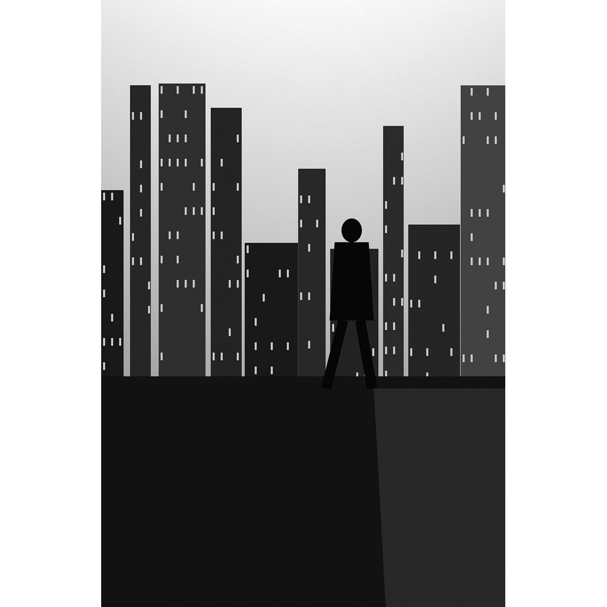
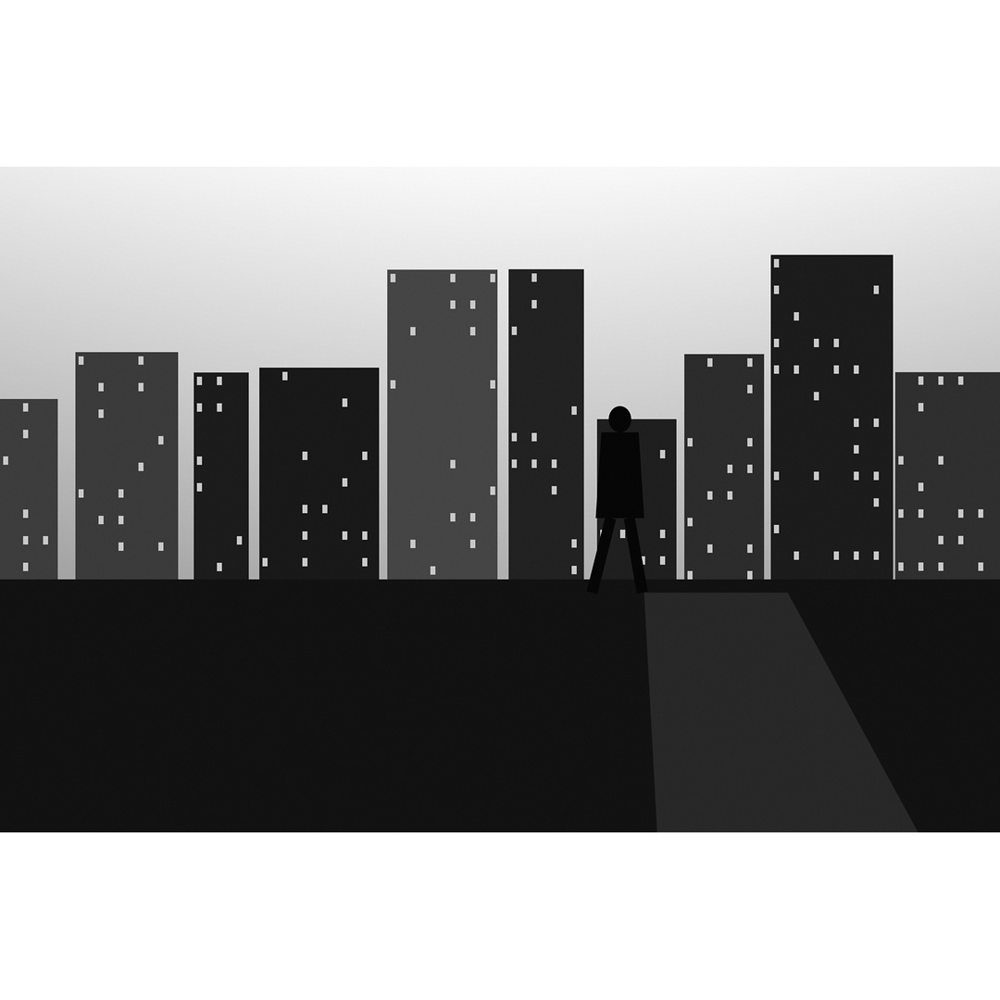
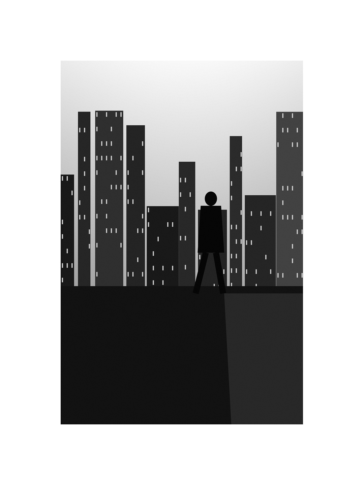
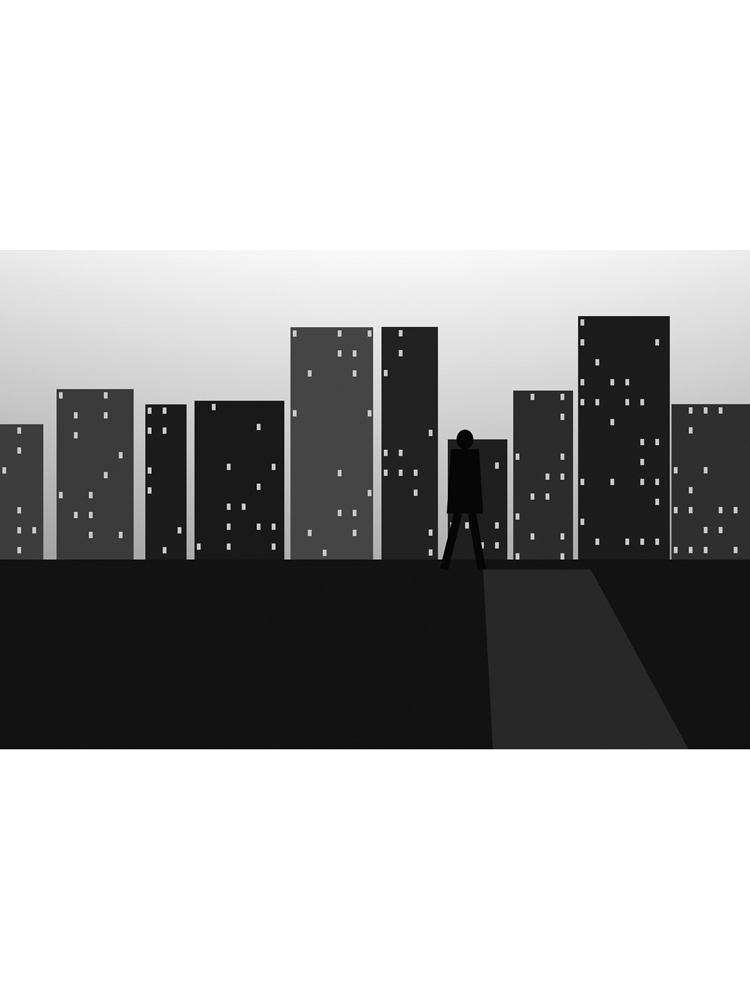
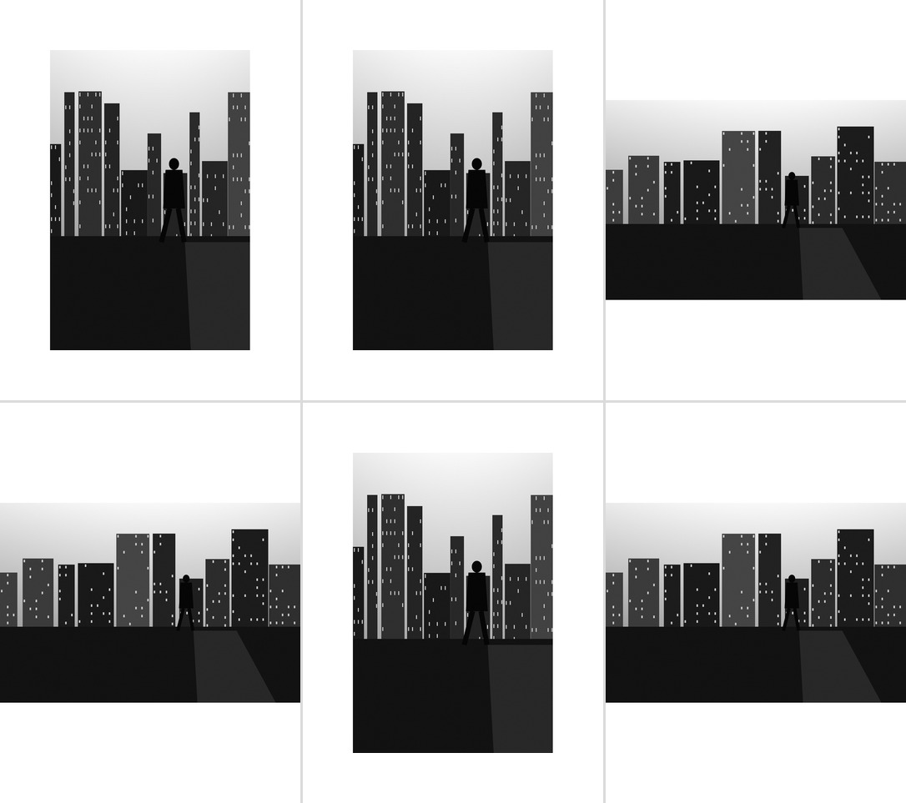

# instagram-borders

A small Python script that puts photos on a white canvas so Instagram shows them **in full, uncropped**.

Instagram can't show a 2:3 vertical photo (like those from a Leica Q3) in full: it crops it to its tallest allowed shape and part of the frame is lost. This tool scales each photo to fit a 1080 px wide canvas and fills the rest with white, giving the clean, gallery-like feed made popular by photographers.

By default the photo touches the canvas edges on its long side: a vertical photo gets white only on the left and right, a horizontal one only above and below.

| Vertical photo | Horizontal photo |
| --- | --- |
|  |  |

## What it does

For every photo it:

1. Applies the camera's EXIF rotation.
2. Converts the colours to sRGB (for example from Adobe RGB or Display P3), which is what Instagram expects.
3. Resizes it with high-quality Lanczos resampling to fit the canvas, then applies a light sharpening to restore crispness lost when downsizing.
4. Centres it on a white canvas (1080 x 1080 by default).
5. Saves a JPEG at quality 95 with full colour resolution (no chroma subsampling) and an embedded sRGB profile.

Input can be a single file or a whole folder. Supported formats: JPEG, PNG, TIFF, WebP, and DNG (with `rawpy`). HEIC is accepted only if your Pillow install can read it; otherwise those files are skipped with a message.

## Requirements

- Python 3.9 or newer
- [Pillow](https://pypi.org/project/pillow/)
- Optional: [rawpy](https://pypi.org/project/rawpy/), only if you want to feed it DNG files directly

```sh
pip3 install pillow
pip3 install rawpy   # optional, for DNG
```

## Usage

```sh
python3 border.py PHOTO_OR_FOLDER [options]
```

Results are written to `./bordered/` as `<original name>_ig.jpg`. If a file fails to load, it is skipped and the rest of the batch continues.

### Examples

```sh
# One photo, default 1080x1080 square
python3 border.py DSC01234.jpg

# A whole folder of Lightroom exports
python3 border.py ~/Pictures/Q3-export

# 4:5 canvas (1080x1350): takes more room in the feed
python3 border.py ~/Pictures/Q3-export --ratio 4:5

# 3:4 canvas (1080x1440)
python3 border.py ~/Pictures/Q3-export --ratio 3:4

# White on every side too (5% of the canvas width as a minimum border)
python3 border.py ~/Pictures/Q3-export --margin 0.05

# Taller 1080x1440 file so the profile grid shows the white frame (see below)
python3 border.py ~/Pictures/Q3-export --grid

# Choose where results go
python3 border.py ~/Pictures/Q3-export --out ~/Desktop/insta
```

### Options

| Option | Default | Description |
| --- | --- | --- |
| `--ratio {1:1,4:5,3:4}` | `1:1` | Canvas shape: 1080x1080, 1080x1350 or 1080x1440 |
| `--margin FRACTION` | `0` | Minimum border on every side, as a fraction of the canvas width (`0.05` = 54 px at 1080 wide) |
| `--grid` | off | Pads the canvas to 3:4 (1080x1440) so the profile grid shows the whole frame; see [The profile grid](#the-profile-grid) |
| `--out FOLDER` | `./bordered` | Output folder (created if needed) |
| `--width PX` | `1080` | Canvas width in pixels (1080 is Instagram's display width) |
| `--color COLOR` | `white` | Border colour, any name or hex Pillow understands, e.g. `black` or `#f4f4f4` |
| `--quality N` | `95` | JPEG quality |
| `--no-sharpen` | off | Skip the light sharpening after resizing |

**Tip:** export full-size JPEGs from Lightroom and let the script do the resizing, colour conversion and rotation.

## Uploading to Instagram

- On the crop screen, choose **Original** (or tap the expand icon) so Instagram keeps the canvas as is instead of cropping it.
- In a carousel, every slide takes the shape of the first one, so use the same `--ratio` for the whole set.

## The profile grid

Instagram's profile grid now shows tiles as 3:4, taller than square (checked October 2026). A square post is therefore cropped at the sides in the grid: a vertical photo on a 1:1 canvas ends up touching the top and bottom of its tile. The post itself, when opened, is shown in full.

You have two ways to handle this:

- **`--grid`**: outputs 1080x1440 files that fill the 3:4 tile exactly, so the grid shows white on all sides. The trade-off is that the opened post also shows extra white above and below the photo.
- **Adjust preview**: Instagram has a setting to adjust how a post is framed in the grid, which may let you keep the square files. This hasn't been verified with this tool.

`--grid` versions of the samples:

| Vertical | Horizontal |
| --- | --- |
|  |  |

Simulated profile grid with `--grid` output:


